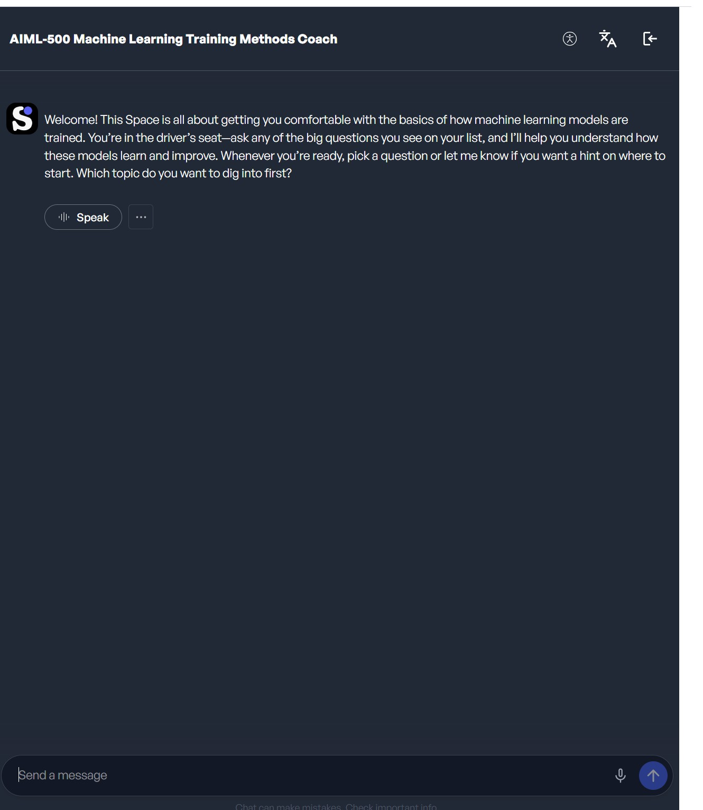

# Machine Learning Training Methods (Chatbot Interaction)

<nav aria-label="Main navigation" style="display:flex;align-items:center;justify-content:center;gap:22px;flex-wrap:wrap;margin:22px auto;padding:12px 16px;border-top:1px solid #e3e8ef;border-bottom:1px solid #e3e8ef;">
  <a href="/parin-ai-portfolio/" style="font-weight:600;text-decoration:none;">Home</a>
  <a href="/parin-ai-portfolio/about" style="font-weight:600;text-decoration:none;">About</a>
  

    
Courses

    

      <a href="/parin-ai-portfolio/aiml-501" style="display:block;padding:8px 0;white-space:nowrap;">AIML-501 — Model Development</a>
      <a href="/parin-ai-portfolio/aiml-500" style="display:block;padding:8px 0;white-space:nowrap;">AIML-500 — Machine Learning Fundamentals</a>
    

  

</nav>

---

## Introduction

This artifact is based on an interactive activity where I worked with an AI chatbot to understand different training methods used in machine learning.

---

## Description

This activity focused on learning how machine learning models are trained through an interactive conversation with a chatbot. Instead of reading static material, the learning happened through asking questions, exploring examples, and understanding concepts step by step.

---

## Objective

The objective of this activity was to learn how machine learning models are trained, including concepts such as supervised learning, unsupervised learning, and reinforcement learning.

---

## Process

In this activity, I used a chatbot to explore machine learning training methods by asking a series of questions.

I asked questions such as:

- How does a supervised learning model learn from the training data?  
- What is the main approach used to train models in unsupervised learning?  
- In reinforcement learning, how does an agent learn the best actions to take?  
- Why are algorithms important in the training of machine learning models?  
- What are the basic steps involved in training a machine learning model?  
- How does repetition (iterating over data) help in training a model?  
- What is the role of examples (data) in training a machine learning model?  

Along with these, I also asked additional follow-up questions to understand the concepts more deeply.

The chatbot responded with explanations and examples, and in some cases asked questions back to check my understanding. This made the interaction feel more like a conversation rather than just a question-and-answer activity.

Overall, the process helped me better understand how different training methods work by actively thinking through the questions instead of just reading the material.

---

## Tools and Technologies Used

- AI Chatbot (Machine Learning Training Methods Coach)  
- Course materials  

---

## Key Concepts Learned

- Supervised learning uses labeled data to train models  
- Unsupervised learning finds patterns in data without labels  
- Reinforcement learning learns through rewards and feedback  
- Training involves repeated iterations over data  
- Data quality and examples directly impact model performance  

---

## Value Proposition

### Unique Value

This artifact demonstrates a different way of learning machine learning concepts through interaction and questioning instead of just reading theory.

### Relevance

Interactive learning using AI tools is becoming more common, and this artifact shows how such tools can help in understanding complex concepts in a more practical and engaging way.

---

## Artifact Evidence

This screenshot shows part of my interaction with the chatbot during the activity.

---

## References

- Course materials on machine learning training methods  
- Chatbot-based learning activity  

*Note: ChatGPT was used only for organizing and refining the content. All questions, understanding, and learning are based on my own interaction with the chatbot.*

---

